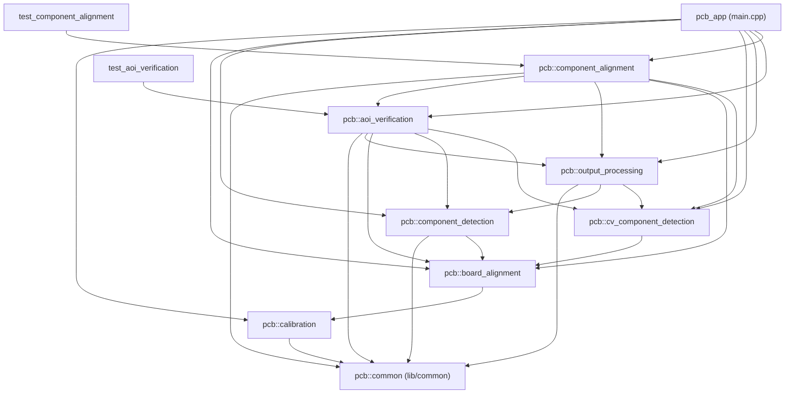

# Documentazione Tecnica del Progetto: PCB Detection and Alignment

Questo documento costituisce il manuale tecnico di riferimento completo per l'intero codebase del progetto **PCB Detection and Alignment**. Descrive l'architettura reale del sistema, la struttura delle cartelle, tutti i tipi di dati personalizzati, ogni funzione implementata in ciascuna libreria e applicazione (con descrizione qualitativa, dettagli tecnici, parametri di input e output) e le convenzioni di progetto. È progettato per consentire a sviluppatori terzi di comprendere lo stato attuale del sistema, individuare rapidamente le funzioni già disponibili e implementare agevolmente nuovi moduli o librerie.

---

## Indice Generale

- [1. Panoramica e Architettura del Sistema](#1-panoramica-e-architettura-del-sistema)
  - [Finalità del Progetto](#finalità-del-progetto)
  - [Pipeline di Elaborazione Completa](#pipeline-di-elaborazione-completa)
  - [Mappa dei Moduli e Dipendenze Reali](#mappa-dei-moduli-e-dipendenze-reali)
- [2. Guida all'Uso e Flusso Operativo per Utenti Esterni](#2-guida-alluso-e-flusso-operativo-per-utenti-esterni)
  - [Prerequisiti Software](#prerequisiti-software)
  - [Compilazione ed Esecuzione](#compilazione-ed-esecuzione)
  - [Flusso di Esecuzione Guidato](#flusso-di-esecuzione-guidato)
- [3. Struttura Dati: Percorsi di Input, Output e Parametri](#3-struttura-dati-percorsi-di-input-output-e-parametri)
  - [Albero delle Cartelle del Progetto](#albero-delle-cartelle-del-progetto)
  - [Cartelle di Input (`data/inputs/`)](#cartelle-di-input-datainputs)
  - [Cartella dei Parametri di Configurazione (`data/parameters/`)](#cartella-dei-parametri-di-configurazione-dataparameters)
  - [Cartelle di Output Prodotte (`data/outputs/`)](#cartelle-di-output-prodotte-dataoutputs)
- [4. Tipi di Dato Personalizzati e Strutture](#4-tipi-di-dato-personalizzati-e-strutture)
  - [Tipi Comuni (`lib/common`)](#tipi-comuni-libcommon)
  - [Tipi: Modulo Calibration](#tipi-modulo-calibration)
  - [Tipi: Modulo Board Alignment](#tipi-modulo-board-alignment)
  - [Tipi: Modulo Component Detection (YOLO)](#tipi-modulo-component-detection-yolo)
  - [Tipi: Modulo CV Component Detection (CV classica)](#tipi-modulo-cv-component-detection-cv-classica)
  - [Tipi: Modulo Output Processing](#tipi-modulo-output-processing)
  - [Tipi: Modulo AOI Verification](#tipi-modulo-aoi-verification)
  - [Tipi: Modulo Component Alignment](#tipi-modulo-component-alignment)
- [5. Documentazione Approfondita delle Librerie](#5-documentazione-approfondita-delle-librerie)
  - [Libreria 1: `common` (Modulo Condiviso)](#libreria-1-common-modulo-condiviso)
    - [`common_utils.hpp` / `common_utils.cpp`](#common_utilshpp--common_utilscpp)
  - [Libreria 2: `calibration`](#libreria-2-calibration)
    - [`calibration.hpp` / `calibration.cpp`](#calibrationhpp--calibrationcpp)
    - [`undistort.hpp` / `undistort.cpp`](#undistorthpp--undistortcpp)
  - [Libreria 3: `board_alignment`](#libreria-3-board_alignment)
    - [`gerber_parser.hpp` / `gerber_parser.cpp`](#gerber_parserhpp--gerber_parsercpp)
    - [`board_edge_detector.hpp` / `board_edge_detector.cpp`](#board_edge_detectorhpp--board_edge_detectorcpp)
    - [`board_alignment.hpp` / `board_alignment.cpp`](#board_alignmenthpp--board_alignmentcpp)
  - [Libreria 4: `component_detection`](#libreria-4-component_detection)
    - [`component_detector.hpp` / `component_detector.cpp`](#component_detectorhpp--component_detectorcpp)
  - [Libreria 5: `cv_component_detection`](#libreria-5-cv_component_detection)
    - [`cv_component_detector.hpp` / `cv_component_detector.cpp`](#cv_component_detectorhpp--cv_component_detectorcpp)
  - [Libreria 6: `output_processing`](#libreria-6-output_processing)
    - [`output_processor.hpp` / `output_processor.cpp` (Orchestratore e I/O)](#output_processorhpp--output_processorcpp-orchestratore-e-io)
    - [`output_merger.cpp` (Step 1: Fusione Multi-Esposizione DL)](#output_mergercpp-step-1-fusione-multi-esposizione-dl)
    - [`output_classifier.cpp` (Step 2: Classificazione Geometrie CV tramite DL)](#output_classifiercpp-step-2-classificazione-geometrie-cv-tramite-dl)
    - [`output_fusion.cpp` (Step 3: Fusione DL e CV)](#output_fusioncpp-step-3-fusione-dl-e-cv)
    - [`output_similarity.cpp` (Armonizzazione e Ricerca per Similarità)](#output_similaritycpp-armonizzazione-e-ricerca-per-similarità)
    - [`output_rendering.cpp` (Visualizzazione e Legende Grafiche)](#output_renderingcpp-visualizzazione-e-legende-grafiche)
  - [Libreria 7: `aoi_verification`](#libreria-7-aoi_verification)
    - [`aoi_verification.hpp` / `aoi_verification.cpp` (Interfaccia e Pipeline)](#aoi_verificationhpp--aoi_verificationcpp-interfaccia-e-pipeline)
    - [`aoi_parser.cpp` (Parsing Dati AOI e Mapping Classi)](#aoi_parsercpp-parsing-dati-aoi-e-mapping-classi)
    - [`aoi_gerber_matcher.cpp` (Estrazione Dimensioni Part Number)](#aoi_gerber_matchercpp-estrazione-dimensioni-part-number)
    - [`aoi_geometric_alignment.cpp` (Allineamento e Omografia 3x3)](#aoi_geometric_alignmentcpp-allineamento-e-omografia-3x3)
    - [`aoi_engine.cpp` (Motore di Verifica, Correzione e Risoluzione Conflitti)](#aoi_enginecpp-motore-di-verifica-correzione-e-risoluzione-conflitti)
    - [`aoi_rendering.cpp` (Overlay Grafici e Legende Diagnostiche)](#aoi_renderingcpp-overlay-grafici-e-legende-diagnostiche)
  - [Libreria 8: `component_alignment`](#libreria-8-component_alignment)
    - [`component_alignment.hpp` / `component_alignment.cpp`](#component_alignmenthpp--component_alignmentcpp)
- [6. Documentazione dei Moduli Applicativi](#6-documentazione-dei-moduli-applicativi)
  - [Punto di Ingresso: `app/src/main.cpp`](#punto-di-ingresso-appsrcmaincpp)
  - [Test Standalone: `app/src/test_aoi_verification.cpp`](#test-standalone-appsrctest_aoi_verificationcpp)
  - [Test Standalone: `app/src/test_component_alignment.cpp`](#test-standalone-appsrctest_component_alignmentcpp)
- [7. Linee Guida per l'Estensione e Nuove Librerie](#7-linee-guida-per-lestensione-e-nuove-librerie)
  - [Servizi Centralizzati Riutilizzabili (`lib/common`)](#servizi-centralizzati-riutilizzabili-libcommon)
  - [Standard di Codifica e Convenzioni di Naming](#standard-di-codifica-e-convenzioni-di-naming)
  - [Integrazione nel Build System CMake](#integrazione-nel-build-system-cmake)

---

## 1. Panoramica e Architettura del Sistema

### Finalità del Progetto
Il sistema **PCB Detection and Alignment** è un framework integrato C++17 per l'ispezione metrologica automatica di circuiti stampati (PCB). Il progetto combina computer vision classica (OpenCV), modelli neurali di object detection (YOLOv8 esportati in formato ONNX) e dati CAD/produzione (file Gerber RS-274X e report macchine AOI - Automated Optical Inspection). L'obiettivo è rilevare con precisione sub-millimetrica ogni componente presente sul PCB, classificarne la tipologia, associarlo univocamente al riferimento schema elettrico (Reference Designator, es. `R12`, `C4`, `U1`), correggerne l'inquadratura prospettica e validarlo rispetto alle specifiche teoriche di fabbricazione.

### Pipeline di Elaborazione Completa
Il flusso di lavoro attraversa 8 fasi sequenziali:

1. **Calibrazione Telecamera (`calibration`)**:
   Stima della matrice intrinseca della fotocamera e dei coefficienti di distorsione radiale/tangenziale tramite pattern scacchiera (checkerboard). Rimozione della distorsione da tutte le immagini acquisite dal braccio robotico con bilanciamento dell'illuminazione (rimozione riflessi speculari metallici su pad e piste).
2. **Allineamento Scheda (`board_alignment`)**:
   Segmentazione automatica del perimetro del PCB (bordi e angoli) su immagini a esposizione multipla, estrazione delle coordinate nominali dal contorno Gerber e stima della matrice di rottotraslazione e del fattore di scala reale in pixel/mm.
3. **Rilevamento Componenti DL (`component_detection`)**:
   Inferenza su porzioni (tiling) ad alta risoluzione tramite rete YOLOv8 (ONNX Runtime) per il riconoscimento di 13 classi di componenti elettronici SMD/THT.
4. **Rilevamento Geometrie CV (`cv_component_detection`)**:
   Rilevamento puramente geometrico tramite computer vision classica (gradienti Canny, sogliatura adattiva e fit di rettangoli/cerchi minimi orientati) per estrarre anche componenti non addestrati o riflettenti.
5. **Fusione ed Elaborazione Output (`output_processing`)**:
   Algoritmo a cascata in 4 step:
   - *Step 1*: fusione multi-esposizione DL con clustering spaziale e voting;
   - *Step 2*: classificazione delle geometrie CV su base DL e inferenza ritagliata;
   - *Step 3*: fusione definitiva CV + DL con abbattimento inclusioni e sovrapposizioni;
   - *Step 4*: armonizzazione per similarità visiva (istogrammi colore HSV e template matching) e propagazione globale delle classi sul PCB.
6. **Verifica e Certificazione AOI (`aoi_verification`)**:
   Associazione delle coordinate teoriche dal file macchina AOI (`.asc`) ai componenti rilevati. Stima di un modello di omografia $3 \times 3$ con correzione locale della distorsione ottica residua, correzione delle classi errate del DL ("il file AOI certifica la classe"), recupero dei componenti mancanti tramite la sovrapposizione multi-foto CV o part number e rimozione di componenti estranei.
7. **Segmentazione Precisa e Modellazione Reale (`component_alignment`)**:
   Rifinitura metrologica ad altissima precisione eseguita componente per componente:
   - Elaborazione ordinata per area decrescente (dai componenti più grandi a quelli più piccoli);
   - Segmentazione CV locale nell'intorno del riquadro per estrarre il contorno reale ed esatto del componente (filtraggio solder mask verde, componenti scuri, pin metallici e condensatori ceramici);
   - Espansione automatica dell'ROI di ricerca in caso di mancato rilevamento iniziale; eliminazione dei componenti non trovati o ricadenti su aree già catalogate;
   - Armonizzazione dimensionale per codice produttore: componenti con medesimo part number hanno lo stesso package e assumono l'ingombro canonico identico;
   - Raccordo del contorno in un rettangolo minimo aderente senza spazi vuoti (uso esclusivo di rettangoli, no cerchi);
   - Calcolo della reale posizione millimetrica corretta con l'inversa dell'omografia di distorsione ottica $3 \times 3$ e determinazione degli errori di posizione $(\Delta x, \Delta y, \Delta d)$ e rotazione $(\Delta \theta)$.
8. **Esportazione e Rendering Grafico**:
   Salvataggio dei risultati in formati aperti (immagini ad alta risoluzione con contorni sottili e colorati, rettangoli minimi, etichette RefDes, file CSV per tracciabilità e file JSON/YAML per integrazione robotica).

### Mappa dei Moduli e Dipendenze Reali




---

## 2. Guida all'Uso e Flusso Operativo per Utenti Esterni

### Prerequisiti Software
- **Compilatore C++**: GCC $\ge 9.0$ o Clang $\ge 11.0$ (con supporto standard C++17).
- **Build System**: CMake $\ge 3.16$.
- **Librerie Esterne Obbligatorie**:
  - OpenCV $\ge 4.5$ con moduli `core`, `imgproc`, `imgcodecs`, `highgui`, `calib3d`, `features2d`.
  - ONNX Runtime $\ge 1.14$ (C++ API).
  - OpenMP (opzionale ma consigliato per velocizzare il processing multi-thread).

### Compilazione ed Esecuzione

```bash
# 1. Configurazione CMake
cmake -B build -S . -DCMAKE_BUILD_TYPE=Release

# 2. Compilazione parallela di tutti i target
cmake --build build -j$(nproc)

# 3. Esecuzione dell'applicazione principale
./build/app/pcb_detection_alignment

# 4. Esecuzione del test standalone per la verifica AOI
./build/app/test_aoi_verification
```

### Flusso di Esecuzione Guidato
All'avvio, `pcb_detection_alignment` guida l'utente tramite interfaccia a riga di comando:
1. **Selezione Scheda e Lato**: L'utente indica la scheda (es. `A`) e il lato (`TOP` o `BOTTOM`).
2. **Calibrazione ed Undistort**: Se i file non sono presenti, calcola i parametri `camera_matrix` e `dist_coeffs` a partire dalle immagini scacchiera in `data/inputs/camera_calibration/` e rimuove la distorsione dalle immagini del robot.
3. **Allineamento**: Rileva i contorni del PCB, li confronta con il contorno Gerber e produce i file raddrizzati in `data/outputs/pcb_board_alignment/`.
4. **Rilevamento Componenti**: Esegue in sequenza YOLOv8 (ONNX) e CV classica su tutte le esposizioni disponibili.
5. **Selezione Grafica Immagine di Riferimento**: Tra le diverse esposizioni, l'utente seleziona l'immagine che funge da sfondo per i rendering finali.
6. **Fusione e Verifica AOI**: Esegue la pipeline di matching rispetto alle coordinate AOI nominali, stimando l'omografia $3 \times 3$ e salvando le annotazioni finali.

---

## 3. Struttura Dati: Percorsi di Input, Output e Parametri

### Albero delle Cartelle del Progetto

```
PcbDetectionAllignmentLeonardo/
├── CMakeLists.txt
├── app/
│   ├── CMakeLists.txt
│   └── src/
│       ├── main.cpp
│       ├── test_aoi_verification.cpp
│       └── test_component_alignment.cpp
├── doc/
│   └── description_of_project.md
├── data/
│   ├── inputs/
│   │   ├── camera_calibration/
│   │   ├── gerber/
│   │   ├── pcb_coordinates_componentes_from_aoi/
│   │   └── robot_images/
│   ├── parameters/
│   └── outputs/
│       ├── pcb_calibration/
│       ├── pcb_board_alignment/
│       ├── pcb_component_detection/
│       ├── pcb_cv_component_detection/
│       ├── pcb_output_processing/
│       ├── pcb_aoi_verification/
│       └── pcb_component_alignment/
└── lib/
    ├── CMakeLists.txt
    ├── common/
    │   ├── CMakeLists.txt
    │   ├── include/common_utils.hpp
    │   └── src/common_utils.cpp
    ├── calibration/
    │   ├── CMakeLists.txt
    │   ├── include/calibration.hpp, undistort.hpp
    │   └── src/calibration.cpp, undistort.cpp
    ├── board_alignment/
    │   ├── CMakeLists.txt
    │   ├── include/gerber_parser.hpp, board_edge_detector.hpp, board_alignment.hpp
    │   └── src/gerber_parser.cpp, board_edge_detector.cpp, board_alignment.cpp
    ├── component_detection/
    │   ├── CMakeLists.txt
    │   ├── include/component_detector.hpp
    │   └── src/component_detector.cpp
    ├── cv_component_detection/
    │   ├── CMakeLists.txt
    │   ├── include/cv_component_detector.hpp
    │   └── src/cv_component_detector.cpp
    ├── output_processing/
    │   ├── CMakeLists.txt
    │   ├── include/output_processor.hpp
    │   └── src/
    │       ├── output_internal.hpp
    │       ├── output_processor.cpp
    │       ├── output_merger.cpp
    │       ├── output_classifier.cpp
    │       ├── output_fusion.cpp
    │       ├── output_similarity.cpp
    │       └── output_rendering.cpp
    └── aoi_verification/
        ├── CMakeLists.txt
        ├── include/aoi_verification.hpp
        └── src/
            ├── aoi_internal.hpp
            ├── aoi_verification.cpp
            ├── aoi_parser.cpp
            ├── aoi_gerber_matcher.cpp
            ├── aoi_geometric_alignment.cpp
            ├── aoi_engine.cpp
            └── aoi_rendering.cpp
    └── component_alignment/
        ├── CMakeLists.txt
        ├── include/component_alignment.hpp
        └── src/component_alignment.cpp
```

### Cartelle di Input (`data/inputs/`)
- **`camera_calibration/`**: Immagini `.bmp` del pattern a scacchiera per la calibrazione intrinseca della camera.
- **`gerber/<BOARD>/<SIDE>/`**: File CAD RS-274X del contorno scheda (`.gko`, `.gm1`, `.bor`, `.art`) e dei layer serigrafici/rame (`.gtl`, `.gts`, `.gto`).
- **`pcb_coordinates_componentes_from_aoi/<BOARD>/<SIDE>/`**: Report testuale `.asc` esportato dalle macchine AOI contenente campi essenziali: `RefDes`, `PartNumber`, coordinate cartesiane nominali $X, Y$ in millimetri, rotazione in gradi, codice package/outline e descrizione componente.
- **`robot_images/<BOARD>/<SIDE>/`**: Immagini raw acquisite dal robot industriale a diversi tempi di esposizione (es. `A_TOP_001.bmp` a `A_TOP_010.bmp`).

### Cartella dei Parametri di Configurazione (`data/parameters/`)
- **`calibration_camera.yml`**: Matrice fotocamera $3 \times 3$ (`camera_matrix`) e vettore dei 5 coefficienti di distorsione (`dist_coeffs`).
- **`board_alignment_<BOARD>_<SIDE>.yml`**: Coordinate dei 4 angoli del PCB, dimensioni millimetriche nominali Gerber, scala calcolata in `pixels_per_mm` e matrice omografica di raddrizzamento.
- **`component_cv_mapping.txt`**: Tabella di associazione persistente tra le righe del file AOI / codici componente e la corrispondente classe del modello di Computer Vision/Deep Learning, arricchita con le dimensioni fisiche reali del package (in millimetri) e la fonte del datasheet:
  `[riga_aoi] --> Class: <Classe> | Dimensions (mm): <Larghezza> x <Lunghezza> [x <Spessore>] | Source: <fonte>`
  (es. `TR103 ... --> Class: Transistor | Dimensions (mm): 10.16 x 15.24 x 4.57 | Source: infineon.com`).
- **`aoi_alignment_<BOARD>_<SIDE>.yml`**: Parametri di allineamento AOI-Immagine: orientazione cartesiana, traslazione $T_x, T_y$, matrice di omografia proiettiva $3 \times 3$ per la correzione della distorsione e metriche di errore inlier.

### Cartelle di Output Prodotte (`data/outputs/`)
- **`pcb_calibration/<BOARD>/<SIDE>/`**: Immagini raddrizzate e corrette geometricamente per rimuovere la distorsione ottica della lente, con illuminazione resa uniforme.
- **`pcb_board_alignment/<BOARD>/<SIDE>/`**: Immagini ritagliate esattamente sul contorno del circuito stampato, orientate con l'origine in alto a sinistra.
- **`pcb_component_detection/<BOARD>/<SIDE>/`**: File CSV dei rilevamenti YOLO per singola esposizione, annotazioni grafiche dei tipi di componenti e dei singoli riquadri.
- **`pcb_cv_component_detection/<BOARD>/<SIDE>/`**: File CSV ed immagini dei componenti geometrici individuati tramite edge detection e contorni OpenCV.
- **`pcb_output_processing/<BOARD>/<SIDE>/`**:
  - `step1_merged_dl_components.csv` e relative annotazioni visuali;
  - `step2_classified_cv_components.csv`;
  - `step3_fused_dl_cv_components.csv`;
  - `final_fused_components.csv` e `final_fused_summary.json` contenenti la fusione consolidata finale.
- **`pcb_aoi_verification/<BOARD>/<SIDE>/`**:
  - `<STEM>_aoi_verified_components.csv`: elenco completo dei componenti con `ref_des`, status (`MATCH_EXACT`, `CLASS_CORRECTED`, `RECOVERED_BY_AOI`), coordinate nominali ed errore reale in px e mm;
  - `<STEM>_aoi_verified_summary.json`: statistiche aggregate, distribuzione classi e parametri di omografia;
  - `<STEM>_best_alignment.jpg`: proiezione ortogonale delle coordinate AOI sui componenti reali;
  - `<STEM>_verified_types.jpg`: immagine pulita con soli codici componente (es. `R301`) e legenda classi;
  - `<STEM>_verified_elements.jpg`: visualizzazione semaforica (Verde = Match DL esatto, Arancione = Classe corretta con AOI, Ciano = Recuperato da sovrapposizione CV).
- **`pcb_component_alignment/<BOARD>/<SIDE>/`**:
  - `<STEM>_precise_aligned_components.csv`: tracciamento dettagliato per componente di `componente_codice`, `tipologia_classe`, `codice_produttore`, `package_outline`, dimensioni box in px e mm, coordinate pixel $(u, v, \theta)$, reale posizione cartesiana millimetrica $(X, Y, \theta)$ corretta con distorsione ottica ed errori metrologici di posizionamento $(\Delta x, \Delta y, \Delta d)$ e rotazione residua $(\Delta \theta)$;
  - `<STEM>_precise_segmented_summary.json`: statistiche complessive, distribuzione per classe, conteggio segmentati/eliminati ed ingombri canonici armonizzati per codice produttore;
  - `<STEM>_segmented_contours.jpg`: immagine ad alta definizione con il contorno reale esatto di ciascun componente tracciato con bordi sottili e colorati in base alla classe con etichette RefDes e legenda laterale;
  - `<STEM>_precise_bounding_boxes.jpg`: immagine con i rettangoli minimi orientati aderenti senza spazi circoscritti attorno a ciascun componente con RefDes e legenda laterale;
  - `intermediate_filters/`: cartella contenente le 21 maschere visive dei filtri intermedi (`01_bilateral_denoised.png` ... `21_final_components_mask.png`) per l'ispezione analitica di ciascuna fase di filtraggio (spazio colore, gradienti cromatici, gradienti morfologici, contrasto adattivo locale, eliminazione vuoti interni).

---

## 4. Tipi di Dato Personalizzati e Strutture

### Tipi Comuni (`lib/common`)
- **`pcb::common`**: Namespace centrale contenente utility condivise per calcolo metrico (IoU, sovrapposizione), gestione file system e palette di visualizzazione.

### Tipi: Modulo Calibration
- **`pcb::CheckerboardConfig`**: Parametri geometrici della scacchiera per la calibrazione:
  - `pattern_size`: numero di vertici interni (`cv::Size(colonne, righe)`);
  - `square_size_mm`: dimensione reale in millimetri di ciascun quadrato (default: `10.0f`).

### Tipi: Modulo Board Alignment
- **`pcb::GerberPad`**: Descrizione geometrica di una piazzola di saldatura nominale:
  - `x`, `y`: coordinate centroide in millimetri;
  - `width`, `height`: ingombro nominale della piazzola;
  - `shape`: `ShapeType::RECTANGLE` o `ShapeType::CIRCLE`;
  - `is_smd`: booleano indicante montaggio superficiale (SMD) o a foro passante (THT).
- **`pcb::GerberData`**: Risultato del parsing del file Gerber:
  - `nominal_corners`: coordinate dei 4 angoli della scheda nel sistema CAD;
  - `nominal_width_mm`, `nominal_height_mm`: larghezza e altezza nominali della scheda;
  - `solder_pads`: vettore contenente tutti i `GerberPad` estratti.
- **`pcb::AlignmentResult`**: Risultato dell'allineamento scheda:
  - `detected_corners`: coordinate in pixel dei 4 angoli trovati sull'immagine reale;
  - `transform_matrix`: matrice $3 \times 3$ per la correzione prospettica;
  - `pixels_per_mm`: fattore di conversione scala risoluzione;
  - `success`: booleano di esito positivo.

### Tipi: Modulo Component Detection (YOLO)
- **`pcb::Component`**: Rilevamento prodotto dalla rete neurale:
  - `id`: identificatore intero progressivo;
  - `box`: riquadro `cv::Rect2f` allineato agli assi;
  - `rotated_box`: riquadro orientato `cv::RotatedRect`;
  - `label`: classe predetta (es. `resistor`, `capacitor_smd`, `ic`);
  - `confidence`: livello di confidenza tra `0.0f` e `1.0f`;
  - `area`: area in pixel quadri del componente;
  - `image_stem`: nome del file immagine di origine.

### Tipi: Modulo CV Component Detection (CV classica)
- **`pcb::ShapeType`**: Enumerazione geometrica (`ShapeType::RECTANGLE`, `ShapeType::CIRCLE`).
- **`pcb::CvComponent`**: Rilevamento geometrico da computer vision:
  - `id`: identificativo univoco;
  - `center`: coordinate del baricentro in pixel;
  - `box`: bounding box rettangolare;
  - `rotated_box`: rettangolo minimo orientato;
  - `shape`: rettangolo o cerchio;
  - `radius`: raggio (se circolare);
  - `area`: area geometrica del contorno;
  - `image_stem`: sorgente immagine di provenienza.

### Tipi: Modulo Output Processing
- **`pcb::DetectionSource`**: Enumeratore sorgente componente (`DEEP_LEARNING`, `COMPUTER_VISION`, `FUSED`, `SIMILARITY_MATCH`).
- **`pcb::FinalComponent`**: Componente consolidato risultante dalla fusione:
  - Estende le proprietà geometriche con `source`, `confidence`, `label` e flag di inclusione/validità.
- **`pcb::output_internal::ComponentVisualFeature`**: Vettore di feature visive (istogramma colore nello spazio HSV normalizzato a 72 bin e patch in scala di grigi per template matching) impiegato nella ricerca globale di componenti simili.

### Tipi: Modulo AOI Verification
- **`pcb::ComponentDatasheetInfo`**: Struttura contenente le specifiche fisiche da datasheet lette da `component_cv_mapping.txt`:
  - `assigned_class`: classe CV associata;
  - `width_mm`, `height_mm`: larghezza e lunghezza/altezza nominali del corpo del componente (in mm);
  - `thickness_mm`: spessore nominale del package (mm);
  - `source`: fonte web o produttore del datasheet (es. `onsemi.com / ti.com`).
- **`pcb::AoiComponent`**: Componente nominale estratto dal file AOI:
  - `ref_des`: identificatore schematico (es. `R301`, `C12`, `U2`);
  - `part_number`: codice componente di magazzino/costruttore;
  - `assigned_class`: classe CV normalizzata (es. `resistor`, `capacitor_smd`);
  - `x_mm`, `y_mm`: coordinate nominali millimetriche sul circuito;
  - `rot_deg`: angolo di rotazione teorico;
  - `outline`: tipologia di package (es. `0603`, `SOT23`, `SOIC8`);
  - `description`: descrizione testuale da distinta base;
  - `datasheet_width_mm`, `datasheet_height_mm`, `datasheet_thickness_mm`, `datasheet_source`: dimensioni fisiche e fonte datasheet dal mapping;
  - `matched`: booleano indicante se è stato associato a un componente visivo;
  - `matched_detection_id`: ID del componente visivo agganciato;
  - `nominal_px`: coordinate proiettate sull'immagine in pixel.
- **`pcb::AoiMatchStatus`**: Enumerazione dello stato di associazione metrologica:
  - `MATCH_EXACT_CLASS`: componente reale riconosciuto da DL la cui classe concorda con il dato AOI;
  - `CLASS_CORRECTED`: componente reale individuato la cui classe errata predetta dal DL è stata corretta con quella del file AOI;
  - `RECOVERED_BY_AOI`: componente non individuato dal DL, recuperato mediante la sovrapposizione di tutte le foto CV o tramite la geometria nominale del part number;
  - `UNMATCHED_DETECTION`: rilevamento reale privo di corrispondenza nei dati AOI (componente extra, escluso dalle rappresentazioni grafiche).
- **`pcb::AoiAlignmentTransform`**:
  - `orientation_name`: rotazione di base trovata (`rot0`, `rot90`, `rot180`, `rot270`);
  - `homography_3x3`: matrice di omografia proiettiva $3 \times 3$ per la correzione della distorsione ottica e di planarità;
  - `tx`, `ty`: offset di traslazione;
  - `scale_px_per_mm`: fattore di scala;
  - `inlier_count`, `inlier_ratio`: metriche di validità RANSAC;
  - `avg_error_px`, `avg_error_mm`: residuo medio di allineamento metrologico.
- **`pcb::VerifiedPcbComponent`**: Struttura unificata finale esportata nel report CSV/JSON e rappresentata a video, arricchita con i campi da datasheet (`datasheet_width_mm`, `datasheet_height_mm`, `datasheet_thickness_mm`, `datasheet_source`).

### Tipi: Modulo Component Alignment
- **`pcb::AlignedComponent`**: Rappresentazione completa del componente dopo segmentazione fine e fit del rettangolo:
  - `id`: identificatore intero univoco;
  - `ref_des`: codice componente (es. `R301`, `IC204`, `C12`);
  - `label`: tipologia/classe associata (es. `resistor`, `ic`, `capacitor_smd`);
  - `part_number`: codice produttore / distinta base;
  - `outline`: codice footprint/package CAD (es. `SOT553`, `0603`);
  - `contour`: vettore `std::vector<cv::Point>` contenente i punti del contorno reale estratto;
  - `found`: flag booleano di esito positivo della segmentazione;
  - `search_expansion_level`: livello di espansione ROI (`0` = ROI base, `1` = ROI espansa, `2` = mantenuto box originario);
  - `rotated_box`: rettangolo minimo orientato circoscritto (`cv::RotatedRect`);
  - `bounding_box`: bounding box allineato agli assi (`cv::Rect2f`);
  - `pixel_center`: centroide in pixel $(u, v)$;
  - `box_width_px`, `box_height_px`: dimensioni del rettangolo in pixel (armonizzate per codice produttore);
  - `box_width_mm`, `box_height_mm`: dimensioni millimetriche reali dell'ingombro del package;
  - `datasheet_width_mm`, `datasheet_height_mm`, `datasheet_thickness_mm`, `datasheet_source`: dimensioni e fonte da datasheet di riferimento;
  - `pixel_angle_deg`: orientamento geometrico in pixel (gradi);
  - `area_px`: area poligonale del contorno reale;
  - `nominal_x_mm`, `nominal_y_mm`, `nominal_rot_deg`: coordinate teoriche CAD;
  - `nominal_center_px`: centro nominale proiettato sull'immagine;
  - `real_x_mm`, `real_y_mm`: reale posizione millimetrica corretta tramite l'inversa dell'omografia di distorsione ottica;
  - `real_rot_deg`: reale orientamento angolare in gradi nel sistema CAD;
  - `error_x_mm`, `error_y_mm`: componenti cartesiane dell'errore di posizionamento $(\text{reale} - \text{nominale})$;
  - `error_dist_mm`, `error_dist_px`: errore euclideo assoluto di posizionamento $(\approx 0.1 \div 0.8\text{ mm})$;
  - `error_rot_deg`: errore angolare di rotazione rispetto alla specifica nominale $(\approx 0^\circ \div 2^\circ)$;
  - `notes`: tracciamento diagnostico.
- **`pcb::ComponentAlignmentConfig`**: Parametri operativi di segmentazione:
  - `initial_margin_ratio`: margine relativo ROI iniziale (default: `0.25`);
  - `expanded_margin_ratio`: margine relativo per casella espansa (default: `0.60`);
  - `min_contour_area`: soglia minima superficie in pixel (default: `8.0`);
  - `max_overlap_with_cataloged`: soglia massima di sovrapposizione su aree già catalogate (default: `0.55`);
  - `harmonize_part_number_sizes`: flag per forzare stesso ingombro per componenti con medesimo part number (default: `true`);
  - `contour_thickness`: spessore linea dei contorni colorati nel render (default: `1`);
  - `save_intermediate_filters`: salvataggio automatico su disco delle immagini intermedie dei filtri (default: `true`);
  - `show_windows`: flag visualizzazione interattiva finestre GUI.
- **`pcb::ComponentAlignmentSummary`**: Metriche statistiche complessive:
  - `total_input_components`, `successfully_aligned`, `found_in_initial_roi`, `found_in_expanded_roi`, `preserved_original_box`, `rejected_not_found`, `rejected_overlap_cataloged`;
  - `mean_error_dist_mm`, `mean_error_dist_px`, `mean_error_rot_deg`;
  - `canonical_part_sizes_px`, `canonical_part_sizes_mm`, `class_distribution`.
- **`pcb::ComponentAlignmentResult`**: Oggetto risultato con vettori componenti, statistiche, maschere e immagini rendering:
  - `aligned_components`: componenti validati con contorno e dimensioni aderenti;
  - `contours_vis`, `tight_boxes_vis`: immagini ad alta definizione con rendering di contorni e riquadri minimi;
  - `cataloged_mask`: maschera binaria delle aree occupate dai componenti catalogati;
  - `intermediate_filter_masks`: mappa nominativa delle 19 maschere dei filtri intermedi.

---

## 5. Documentazione Approfondita delle Librerie

### Libreria 1: `common` (Modulo Condiviso)

La libreria `pcb::common` (`lib/common/`) centralizza tutte le funzionalità matematiche, di manipolazione file system e di rendering condivise da più moduli del sistema.

#### `common_utils.hpp` / `common_utils.cpp`

##### 1. `pcb::common::moveToOkFolder`
- **Descrizione Qualitativa**:
  Verifica se un file immagine non distorto esiste e non è corrotto, e lo sposta/copia nella directory di destinazione con gestione sicura degli errori e creazione atomica delle cartelle.
- **Dettagli Tecnici**:
  Utilizza `std::filesystem` per controllare la presenza del file sorgente, verifica che non sia vuoto (`file_size > 0`), crea l'albero delle directory di destinazione se mancante ed esegue `std::filesystem::copy_file` con opzione `overwrite_existing`.
- **Firma e Parametri**:
  ```cpp
  bool moveToOkFolder(const std::string& srcPath, const std::string& dstFolder);
  ```
  - *Input*: `srcPath` (percorso assoluto o relativo del file immagine sorgente), `dstFolder` (cartella di destinazione).
  - *Output*: `true` se il file è valido e l'operazione è riuscita, `false` altrimenti.

##### 2. `pcb::common::calculateIoU`
- **Descrizione Qualitativa**:
  Calcola l'indice di Jaccard (Intersection over Union - IoU) tra due bounding box bidimensionali.
- **Dettagli Tecnici**:
  Determina il rettangolo di intersezione `r1 & r2`. Se l'area di intersezione è nulla, ritorna immediatamente `0.0f`. Altrimenti calcola:
  $$\text{IoU} = \frac{\text{Area}(r1 \cap r2)}{\text{Area}(r1) + \text{Area}(r2) - \text{Area}(r1 \cap r2)}$$
- **Firma e Parametri**:
  ```cpp
  float calculateIoU(const cv::Rect2f& r1, const cv::Rect2f& r2);
  ```
  - *Input*: due riquadri `r1` e `r2` di tipo `cv::Rect2f`.
  - *Output*: valore scalare `float` compreso nell'intervallo $[0.0, 1.0]$.

##### 3. `pcb::common::calculateOverlap`
- **Descrizione Qualitativa**:
  Calcola la percentuale di area di un rettangolo coperta o inclusa all'interno di un altro rettangolo.
- **Dettagli Tecnici**:
  Calcola il rapporto tra l'area di intersezione e l'area minima tra i due rettangoli:
  $$\text{Overlap} = \frac{\text{Area}(r1 \cap r2)}{\min(\text{Area}(r1), \text{Area}(r2))}$$
  Questo indicatore è fondamentale per riconoscere quando un componente è contenuto all'interno di un altro o quando una geometria CV è un sotto-elemento di un box DL.
- **Firma e Parametri**:
  ```cpp
  float calculateOverlap(const cv::Rect2f& r1, const cv::Rect2f& r2);
  ```
  - *Input*: due riquadri `r1` e `r2` di tipo `cv::Rect2f`.
  - *Output*: percentuale di sovrapposizione normalizzata $[0.0, 1.0]$.

##### 4. `pcb::common::getDefaultClasses`
- **Descrizione Qualitativa**:
  Fornisce la lista canonica unificata delle classi di componenti elettronici supportate dal sistema.
- **Dettagli Tecnici**:
  Ritorna un vettore immutabile contenente le 13 etichette standard del dataset:
  `resistor`, `capacitor_smd`, `capacitor_thru_hole`, `inductor_smd`, `diode`, `led`, `transistor`, `ic`, `connector`, `test_point`, `switch`, `potentiometer`, `oscillator`.
- **Firma e Parametri**:
  ```cpp
  std::vector<std::string> getDefaultClasses();
  ```
  - *Output*: `std::vector<std::string>` con le 13 stringhe identificative.

##### 5. `pcb::common::getShortLabel`
- **Descrizione Qualitativa**:
  Genera la sigla abbreviata ad alta leggibilità associata a ciascuna classe di componenti.
- **Dettagli Tecnici**:
  Mappa tramite lookup table le stringhe lunghe nei corrispettivi simboli grafici compatti (es. `resistor` $\to$ `R`, `capacitor_smd` $\to$ `C_SMD`, `ic` $\to$ `IC`).
- **Firma e Parametri**:
  ```cpp
  std::string getShortLabel(const std::string& label);
  ```
  - *Input*: stringa estesa della classe.
  - *Output*: stringa abbreviata per overlay grafici.

##### 6. `pcb::common::getPalette`
- **Descrizione Qualitativa**:
  Restituisce la tavolozza colori standard in formato BGR per la renderizzazione delle annotazioni.
- **Dettagli Tecnici**:
  Associa a ciascuna classe canonica un colore `cv::Scalar(B, G, R)` percettivamente distinto per garantire massimo contrasto su PCB verdi, blu o neri.
- **Firma e Parametri**:
  ```cpp
  std::map<std::string, cv::Scalar> getPalette();
  ```
  - *Output*: mappa chiave-valore `label -> cv::Scalar`.

##### 7. `pcb::common::renderSideLegend`
- **Descrizione Qualitativa**:
  Crea una barra legenda laterale scura professionale con titolo, statistiche complessive e riepilogo grafico delle classi con quadratino colore e conteggio.
- **Dettagli Tecnici**:
  Supporta due overload: uno basato su mappa e uno basato su vettore di coppie per visualizzare statistiche ordinate. Costruisce una `cv::Mat` a 3 canali con sfondo uniforme grigio scuro `RGB(24, 24, 24)`, separatori grafici e testo anti-aliased `cv::LINE_AA`.
- **Firma e Parametri**:
  ```cpp
  cv::Mat renderSideLegend(
      int targetHeight,
      const std::map<std::string, int>& counts,
      int totalComps,
      const std::map<std::string, cv::Scalar>& palette,
      const std::string& title = "Legenda",
      const std::vector<std::pair<std::string, int>>& extraStats = {},
      int panelWidth = 340);
  ```
  - *Input*: altezza immagine target, mappa conteggi per classe, totale componenti, mappa colori, titolo, statistiche addizionali opzionali, larghezza pannello in pixel.
  - *Output*: `cv::Mat` contenente il pannello legenda disegnato.

---

### Libreria 2: `calibration`

La libreria `calibration` (`lib/calibration/`) implementa i metodi per la calibrazione geometrica della lente e la rimozione di distorsioni e riflessi luminosi speculari.

#### `calibration.hpp` / `calibration.cpp`

##### 1. `pcb::calibrateCameraSet`
- **Descrizione Qualitativa**:
  Esegue la calibrazione geometrica della camera analizzando una serie di immagini di una scacchiera piana, calcolando matrice intrinseca, coefficienti di distorsione ed errore quadratico medio di riproiezione.
- **Dettagli Tecnici**:
  Cerca i vertici interni con `cv::findChessboardCorners` applicando il flag `CALIB_CB_ADAPTIVE_THRESH + CALIB_CB_NORMALIZE_IMAGE`. Affina i punti a livello sub-pixel con `cv::cornerSubPix`. Esegue `cv::calibrateCamera` e salva i parametri risultanti (`camera_matrix`, `dist_coeffs`, `rms`) nel file YAML specificato.
- **Firma e Parametri**:
  ```cpp
  bool calibrateCameraSet(
      const std::string& imagesDirectory,
      const std::string& outputYamlPath,
      const CheckerboardConfig& config = CheckerboardConfig(),
      bool interactiveMode = false);
  ```

#### `undistort.hpp` / `undistort.cpp`

##### 1. `pcb::uniformLightingAndContrast`
- **Descrizione Qualitativa**:
  Normalizza l'illuminazione sulla scheda, attenuando zone di ombra e appiattendo i riflessi speculari intensi sui terminali metallici dei componenti.
- **Dettagli Tecnici**:
  Converte l'immagine nello spazio Lab. Estrae il canale L (luminanza) e applica l'algoritmo CLAHE (Contrast Limited Adaptive Histogram Equalization) con clip limit a `2.0` su griglia `8x8`. Identifica le aree sovraesposte tramite sogliatura e ne riduce il picco fondendole con una versione sfocata della luminanza.
- **Firma e Parametri**:
  ```cpp
  cv::Mat uniformLightingAndContrast(
      const cv::Mat& inputImage,
      double clipLimit = 2.0,
      cv::Size tileGridSize = cv::Size(8, 8));
  ```

##### 2. `pcb::undistortImages`
- **Descrizione Qualitativa**:
  Carica i parametri intrinseci da file YAML e corregge la distorsione radiale e tangenziale su un insieme di immagini acquisite dal robot.
- **Dettagli Tecnici**:
  Precalcola le mappe di riproiezione con `cv::initUndistortRectifyMap` con matrice camera ottimizzata da `cv::getOptimalNewCameraMatrix`. Applica `cv::remap` con interpolazione bilineare ed effettua la normalizzazione dell'illuminazione prima di salvare le immagini corrette.
- **Firma e Parametri**:
  ```cpp
  bool undistortImages(
      const std::string& inputDir,
      const std::string& outputDir,
      const std::string& calibrationYamlPath);
  ```

---

### Libreria 3: `board_alignment`

La libreria `board_alignment` (`lib/board_alignment/`) coordina il parsing dei file Gerber e la segmentazione del contorno fisico del PCB per determinare la trasformazione prospettica e il fattore di scala reale.

#### `gerber_parser.hpp` / `gerber_parser.cpp`

##### 1. `pcb::GerberParser::parse`
- **Descrizione Qualitativa**:
  Esegue il parsing di un file Gerber contorno (RS-274X) ed estrae il poligono perimetrale della scheda in coordinate millimetriche CAD.
- **Dettagli Tecnici**:
  Interpreta i comandi gerber `FSLAX`, `MOIN`/`MOMM`, le definizioni di apertura `ADD` e i comandi di tracciamento coordinate `G01`, `G02`, `G03`, `D01`, `D02`. Determina il bounding box nominale e ne calcola i 4 angoli cartesiani.
- **Firma e Parametri**:
  ```cpp
  GerberData parse(const std::string& gerberOutlineFilePath);
  ```

#### `board_edge_detector.hpp` / `board_edge_detector.cpp`

##### 1. `pcb::BoardEdgeDetector::combineMultiExposure`
- **Descrizione Qualitativa**:
  Fonde un set di immagini dello stesso PCB acquisite a esposizioni diverse per ottenere un'immagine priva di ombre e con bordi del substrato nitidi.
- **Dettagli Tecnici**:
  Esegue la fusione pesata sul gradiente locale: per ogni pixel seleziona l'intensità che massimizza il contrasto locale senza saturare i canali cromatici.
- **Firma e Parametri**:
  ```cpp
  cv::Mat combineMultiExposure(const std::vector<cv::Mat>& multiExposureImages);
  ```

##### 2. `pcb::BoardEdgeDetector::detectCandidates`
- **Descrizione Qualitativa**:
  Individua sul PCB i poligoni candidati a rappresentare il bordo esterno della scheda.
- **Dettagli Tecnici**:
  Esegue edge detection Canny multi-scala, dilatazione morfologica, estrazione contorni gerarchici con `cv::findContours` e approssimazione poligonale con `cv::approxPolyDP` verificando convessità e superficie minima.
- **Firma e Parametri**:
  ```cpp
  std::vector<std::vector<cv::Point2f>> detectCandidates(const cv::Mat& fusedImage);
  ```

#### `board_alignment.hpp` / `board_alignment.cpp`

##### 1. `pcb::BoardAlignmentProcessor::computeAlignment`
- **Descrizione Qualitativa**:
  Calcola la matrice di allineamento prospettico tra i 4 angoli trovati sull'immagine e le coordinate nominali Gerber, determinando il fattore di conversione scala pixel/millimetro.
- **Dettagli Tecnici**:
  Ordina gli angoli (Top-Left, Top-Right, Bottom-Right, Bottom-Left) e calcola la matrice di trasformazione prospettica $3 \times 3$ con `cv::getPerspectiveTransform`. Calcola la scala dividendo la larghezza media in pixel per la larghezza nominale in millimetri.
- **Firma e Parametri**:
  ```cpp
  AlignmentResult computeAlignment(
      const std::vector<cv::Point2f>& detectedCorners,
      const GerberData& gerberData);
  ```

##### 2. `pcb::BoardAlignmentProcessor::cropAlongBoardEdge`
- **Descrizione Qualitativa**:
  Raddrizza e ritaglia l'immagine esattamente lungo il perimetro del PCB, escludendo il piano di appoggio dello sfondo.
- **Firma e Parametri**:
  ```cpp
  cv::Mat cropAlongBoardEdge(const cv::Mat& inputImage, const AlignmentResult& alignment);
  ```

---

### Libreria 4: `component_detection`

La libreria `component_detection` (`lib/component_detection/`) implementa l'inferenza di Deep Learning basata su modelli YOLOv8 (ONNX Runtime) per il riconoscimento delle classi di componenti elettronici.

#### `component_detector.hpp` / `component_detector.cpp`

##### 1. `pcb::ComponentDetector::detect`
- **Descrizione Qualitativa**:
  Esegue la detection dei componenti su un'immagine ad alta risoluzione mediante una strategia a piastrelle (tiling) con sovrapposizione e soppressione dei non-massimi (NMS).
- **Dettagli Tecnici**:
  Divide l'immagine PCB in tile da $640 \times 640$ con overlap di 128 pixel per preservare componenti tagliati sui bordi. Esegue il forward pass su ONNX Runtime, riscala le coordinate al sistema di riferimento globale dell'immagine PCB e fonde i riquadri duplicati calcolando l'IoU (`pcb::common::calculateIoU`) con soglia NMS a `0.45`.
- **Firma e Parametri**:
  ```cpp
  std::vector<Component> detect(
      const cv::Mat& image,
      float confThreshold = 0.25f,
      float nmsThreshold = 0.45f);
  ```

##### 2. `pcb::ComponentDetector::saveResults`
- **Descrizione Qualitativa**:
  Esporta l'elenco dei componenti rilevati in un file CSV strutturato e salva le immagini annotate su disco.
- **Firma e Parametri**:
  ```cpp
  bool saveResults(
      const std::string& outputCsvPath,
      const std::string& outputImagePath,
      const cv::Mat& image,
      const std::vector<Component>& components);
  ```

---

### Libreria 5: `cv_component_detection`

La libreria `cv_component_detection` (`lib/cv_component_detection/`) individua i componenti basandosi sulla sola geometria di Computer Vision classica (gradienti e binarizzazione), senza richiedere modelli addestrati.

#### `cv_component_detector.hpp` / `cv_component_detector.cpp`

##### 1. `pcb::CvComponentDetector::detect`
- **Descrizione Qualitativa**:
  Estrae tutti i profili geometrici chiusi (rettangolari o circolari) presenti sul circuito stampato, filtrando le piste di rame e il rumore di fondo.
- **Dettagli Tecnici**:
  Calcola le soglie Canny in modo dinamico in base alla mediana dell'intensità dell'immagine. Estrae i contorni con `cv::findContours(RETR_EXTERNAL, CHAIN_APPROX_SIMPLE)`. Per ciascun contorno calcola il rettangolo minimo orientato (`cv::minAreaRect`) e il cerchio minimo (`cv::minEnclosingCircle`), calcolando aspect ratio, solidità e area per escludere artefatti.
- **Firma e Parametri**:
  ```cpp
  CvDetectionResult detect(const cv::Mat& image, const CvDetectionConfig& config);
  ```

---

### Libreria 6: `output_processing`

La libreria `output_processing` (`lib/output_processing/`) integra, armonizza e consolida i risultati di Deep Learning e Computer Vision classica. È strutturata in moduli specialistici.

#### `output_processor.hpp` / `output_processor.cpp` (Orchestratore e I/O)
- **`sourceToString`**: converte l'enum `DetectionSource` in stringa esplicativa per report CSV (`DL_ONLY`, `CV_ONLY`, `FUSED`, `SIMILARITY_MATCH`, `RECOVERED_AOI`).
- **`calculateIoU` e `calculateOverlap`**: forwarder ai metodi centralizzati di `pcb::common`.
- **`loadDlDetectionsCsv`**:
  - *Descrizione Qualitativa*: Carica in memoria i rilevamenti eseguiti dalla rete neurale YOLOv8 esportati in formato CSV da `ComponentDetector::saveResults`.
  - *Dettagli Tecnici*: Esegue il parsing elastico e robusto del file `*_detections.csv` a 8 colonne (`id, label, box_conf, label_conf, x0, y0, x1, y1`). Effettua il trim dei whitespace, converte le coordinate cartesiane $(x_0, y_0, x_1, y_1)$ nel rettangolo `cv::Rect2f(x0, y0, std::max(0.0f, x1 - x0), std::max(0.0f, y1 - y0))` e legge le confidenze del riquadro e della classe semantica. Supporta retro-compatibilità con formati alternativi o colonne opzionali.
- **`loadCvComponentsCsv`**:
  - *Descrizione Qualitativa*: Carica in memoria i componenti geometrici individuati dalla Computer Vision classica esportati da `CvComponentDetector::saveResults`.
  - *Dettagli Tecnici*: Esegue il parsing del file `*_components_cv.csv` a 10 colonne (`id, shape, center_x, center_y, width, height, angle_deg, radius, area, circularity`). Determina la forma (`ShapeType::CIRCLE` o `ShapeType::RECTANGLE`), istanzia il rettangolo orientato circoscritto `cv::RotatedRect(center, Size2f(w, h), angle)` e il bounding box allineato agli assi, calcola l'aspect ratio e carica raggio, area e indice di circolarità.
- **`loadAllDlDetectionsInDir`**:
  - *Descrizione Qualitativa*: Scansiona ricorsivamente una directory ed estrae tutti i file CSV dei rilevamenti DL associati a ciascuna esposizione.
  - *Dettagli Tecnici*: Identifica i file con suffisso `_detections.csv`, estrae lo stem del file immagine corrispondente (es. `A_TOP_003`) e popola una mappa indicizzata `std::map<std::string, std::vector<ComponentDetection>>`.
- **`saveAllStepResults`**: serializza su disco i file CSV di ciascuno dei 4 step (`step1_merged_dl_detections.csv`, `step2_cv_dl_detections.csv`, `final_fused_components.csv`) e i rispettivi riepiloghi JSON (`step1_merged_dl_summary.json`, `step2_cv_dl_summary.json`, `final_fused_summary.json`).
- **`processBoardSide`**: metodo principale che esegue la sequenza completa dei 4 step di elaborazione su tutte le foto della scheda, gestisce la selezione dell'immagine di sfondo da parte dell'utente e salva i rendering.

#### `output_merger.cpp` (Step 1: Fusione Multi-Esposizione DL)
- **`mergeMultiExposureDl`**:
  - *Descrizione Qualitativa*: Fonde le predizioni di Deep Learning provenienti dalle differenti immagini a esposizione multipla in un unico insieme coerente.
  - *Dettagli Tecnici*: Esegue un clustering spaziale basato su distanza centroide e IoU. Per ogni cluster di rilevamenti coincidenti, determina la classe finale tramite algoritmo di voto a maggioranza; in caso di parità, assegna la classe con la confidenza media ponderata più alta e calcola le coordinate medie del box.

#### `output_classifier.cpp` (Step 2: Classificazione Geometrie CV tramite DL)
- **`classifyCvComponentsWithDl`**:
  - *Descrizione Qualitativa*: Assegna una classe semantica ai rettangoli geometrici trovati dalla CV classica sfruttando i rilevamenti DL circostanti.
  - *Dettagli Tecnici*: Se un box CV presenta una sovrapposizione significativa con un rilevamento DL, adotta la classe del DL; per geometrie isolate di piccole dimensioni non riconosciute da YOLO, verifica se rientrano nei criteri dimensionali tipici dei componenti passivi SMD (es. 0402, 0603).
- **`isTinyUnclassified`**: helper che identifica geometrie inferiori a una determinata soglia di area.

#### `output_fusion.cpp` (Step 3: Fusione DL e CV)
- **`fuseDlAndCv`**:
  - *Descrizione Qualitativa*: Crea un unico elenco combinato integrando i componenti DL e le geometrie CV classificate.
- **`resolveEnclosingAndOverlaps`**:
  - *Descrizione Qualitativa*: Risolve i conflitti geometrici e le inclusioni improprie tra componenti.
  - *Dettagli Tecnici*: Quando un box piccolo è completamente inscritto dentro un box grande (es. un pin all'interno di un package IC), analizza le classi: se il box grande è un circuito integrato (`ic`) o un connettore (`connector`), il box interno viene eliminato come duplicato locale. Tra componenti simili sovrapposti, preserva il box con confidenza maggiore riducendo l'ingombro del secondo.

#### `output_similarity.cpp` (Armonizzazione e Ricerca per Similarità)
- **`harmonizeIdenticalComponents`**:
  - *Descrizione Qualitativa*: Corregge le discrepanze di classificazione tra componenti aventi aspetto visivo identico.
  - *Dettagli Tecnici*: Estrae le feature cromatiche e tessiturali (`ComponentVisualFeature`). Quando due componenti hanno dimensioni geometriche quasi identiche e correlazione cromatica HSV superiore alla soglia di similarità (default `0.82`), uniforma la loro classe verso quella supportata da confidenza maggiore.
- **`searchSimilarComponentsOnBoard`**: scansiona la scheda alla ricerca di componenti passivi identici non rilevati in precedenza.

#### `output_rendering.cpp` (Visualizzazione e Legende Grafiche)
- **`createSideLegendPanel`**: costruisce il pannello laterale scuro con le classi e i conteggi.
- **`renderStep1MultiExposureMerge`**, **`renderStep2ClassifiedCv`**, **`renderStep3DlCvFusion`**, **`renderStep4VisualSimilarity`**, **`renderFinalResult`**: metodi di disegno dedicati che producono le immagini diagnostiche complete di box orientati, centroidi e legenda laterale.

---

### Libreria 7: `aoi_verification`

La libreria `aoi_verification` (`lib/aoi_verification/`) esegue la verifica metrologica finale, combinando i rilevamenti visivi con i dati CAD/AOI nominali di fabbricazione.

#### `aoi_verification.hpp` / `aoi_verification.cpp` (Interfaccia e Pipeline)
- **`AoiVerificationProcessor`**: classe principale del modulo.
- **`getSupportedClasses`**: ritorna le 13 classi standard delegando a `pcb::common::getDefaultClasses()`.
- **`saveResults`**: esporta `<STEM>_aoi_verified_components.csv`, `<STEM>_aoi_verified_summary.json`, i parametri di allineamento `<STEM>_aoi_alignment.yml` e le tre immagini di visualizzazione.
- **`processBoardSide`**: coordina il parsing del file AOI, il caricamento della sovrapposizione CV multi-foto, la stima della rotazione/omografia, la verifica delle classi, il recupero dei mancanti e il salvataggio dei risultati.

#### `aoi_parser.cpp` (Parsing Dati AOI, Mapping Classi e Dimensioni Datasheet)
- **`loadMappingFile`**: carica dal file persistente `data/parameters/component_cv_mapping.txt` le corrispondenze note tra righe/part number AOI, classi CV e dimensioni fisiche nominali da datasheet (`Dimensions (mm): W x H [x Thick] | Source: <fonte>`).
- **`saveMappingEntry`**: appende atomicamente una nuova associazione nel file di mapping includendo classe, dimensioni millimetriche e fonte del datasheet.
- **`inferClassFromKeywords`**: algoritmo euristico che analizza campi come `description`, `part_number` e `outline` del file AOI cercando parole chiave (es. `RES`, `CAP`, `DIODE`, `LED`, `SOIC`, `QFP`) per determinare automaticamente la classe.
- **`askUserForClass`**: in modalità interattiva, se un componente non è presente in `component_cv_mapping.txt`, stampa a terminale una guida completa e dettagliata per l'utente su come reperire le informazioni online:
  1. Istruzioni di ricerca del codice produttore (`part_number`) o package (`outline`) su motori di ricerca e portali specializzati (Octopart, DigiKey, Mouser o siti ufficiali come TI, NXP, Infineon, Vishay);
  2. Come consultare la sezione "Package / Mechanical Data" del datasheet per ricavare Larghezza ($W$), Lunghezza ($H$) e Spessore ($T$) in millimetri;
  3. Il formato esatto della stringa attesa per l'aggiornamento automatico del file:
     `--> Class: <Classe> | Dimensions (mm): <W> x <H> [x <Thick>] | Source: <fonte>`
  4. Possibilità di incollare la riga completa direttamente a terminale oppure di procedere tramite menu guidato passo-passo.
- **`parseAoiFile`**: analizza il file `.asc`, scarta intestazioni e righe di test, ed estrae la lista completa di `AoiComponent` arricchita con le coordinate millimetriche, rotazioni e dimensioni reali da datasheet.

#### `aoi_gerber_matcher.cpp` (Estrazione Dimensioni Part Number)
- **`getNominalOutlineDimensions`**: converte le sigle di package standard (es. `0603`, `0805`, `1206`, `SOT23`) nelle dimensioni nominali in millimetri (larghezza e altezza).

#### `aoi_geometric_alignment.cpp` (Allineamento e Omografia 3x3)
- **`aoiToPixel`**: trasforma un punto $(x_{\text{mm}}, y_{\text{mm}})$ dal sistema di coordinate AOI a coordinate pixel $(u, v)$ sull'immagine reale. Applica la rotazione di base e, se presente, moltiplica per la matrice di omografia proiettiva $3 \times 3$:
  $$\begin{bmatrix} u' \\ v' \\ w \end{bmatrix} = \mathbf{H}_{3 \times 3} \begin{bmatrix} x_{\text{rot}} \\ y_{\text{rot}} \\ 1 \end{bmatrix}, \quad u = \frac{u'}{w}, \quad v = \frac{v'}{w}$$
- **`findBestOriginAndDistortionAlignment`**:
  - *Descrizione Qualitativa*: Individua l'orientazione corretta della scheda tra le 4 rotazioni possibili ($0^\circ, 90^\circ, 180^\circ, 270^\circ$) e stima una matrice di omografia $3 \times 3$ per correggere la distorsione ottica della lente e la planarità del circuito.
  - *Dettagli Tecnici*: Testa le 4 traslazioni mediante correlazione dei baricentri dei componenti principali (IC e package grandi). Selezionata l'orientazione con il maggior numero di inlier, preleva le coppie di punti corrispondenti ed esegue `cv::findHomography(..., cv::RANSAC, ransacReprojThreshold = 3.5)`. Se gli inlier superano il $40\%$, attiva il modello di distorsione omografica, garantendo un errore residuo tipico inferiore a $0.5\text{ mm}$.

#### `aoi_engine.cpp` (Motore di Verifica, Correzione e Risoluzione Conflitti)
- **`loadAllCvDetectionsForBoardSide`**: carica tutti i rilevamenti geometrici salvati nei file `_components_cv.csv` di tutte le esposizioni disponibili per la scheda, creando un pool denso di elementi geometrici reali.
- **`resolveOverlapsWithDl`**:
  - *Descrizione Qualitativa*: Elimina qualsiasi sovrapposizione geometrica tra componenti, applicando la regola vincolante: "il Deep Learning ha priorità assoluta e i suoi riquadri non si modificano; i componenti CV o recuperati vengono ridimensionati o ritagliati".
  - *Dettagli Tecnici*: Se un box recuperato interseca un box DL confermato, ne riduce l'ampiezza o l'altezza fino al bordo del componente DL. Applica lo stesso principio tra componenti recuperati adiacenti.
- **`verifyAndClassify`**:
  - *Fase 1*: associa le coordinate teoriche proiettate ai riquadri DL entro la soglia di tolleranza; assegna lo status `MATCH_EXACT_CLASS` (se le classi concordano) o `CLASS_CORRECTED` (la classe predetta dal DL viene sovrascritta con la classe certa del file AOI); memorizza le dimensioni canoniche per ciascun `part_number`.
  - *Fase 2*: per i componenti teorici non trovati dal DL, cerca nel pool multi-foto CV l'elemento geometrico più vicino e calcola la mediana delle dimensioni; se assente in CV, ricostruisce il riquadro utilizzando le dimensioni DL memorizzate per lo stesso `part_number` (assegnando status `RECOVERED_BY_AOI`).
  - *Fase 3*: risolve le sovrapposizioni mutue (`resolveOverlapsWithDl`).
  - *Fase 4*: contrassegna i componenti rilevati dal DL privi di riscontro AOI come `UNMATCHED_DETECTION` (componenti estranei, esclusi dalle annotazioni grafiche).

#### `aoi_rendering.cpp` (Overlay Grafici e Legende Diagnostiche)
- **`createSideLegend`**: delega a `pcb::common::renderSideLegend` per la composizione della legenda.
- **`renderBestAlignmentOverlay`**: disegna i marker a croce delle coordinate teoriche AOI e i vettori di collegamento giallo ai centroidi reali dei componenti agganciati, con intestazione recante l'errore medio residuo.
- **`renderVerifiedTypesOverlay`**: disegna i riquadri dei componenti con colore per classe e riporta esclusivamente il riferimento schematico (es. `R301`, `C12`, `U2`), senza testo superfluo. Esclude tassativamente i componenti extra non presenti nel file AOI.
- **`renderVerifiedElementsOverlay`**: visualizzazione diagnostica semaforica a tre stati: Verde (`MATCH_EXACT_CLASS`), Arancione (`CLASS_CORRECTED`), Ciano (`RECOVERED_BY_AOI`), con barra legenda laterale riassuntiva.

---

### Libreria 8: `component_alignment`

La libreria `component_alignment` (`lib/component_alignment/`) implementa l'architettura per la modellazione geometrica fine dei componenti PCB, l'armonizzazione fisica assoluta delle dimensioni in millimetri per codice produttore (`part_number`), e la stima congiunta di micro-traslazioni ($\le \pm 0.35\text{ mm}$) e micro-rotazioni ($\le \pm 3.0^\circ$) mediante la fusione sinergica di **Caliper 1D Edge Profiling (Opzione 2)** e **Edge-Template Matching su Griglia 3D (Opzione 1)**.

#### `component_alignment.hpp` / `component_alignment.cpp`

##### 1. Estrazione del Gradiente Multi-Esposizione e Maschere Diagnostiche
- **Descrizione Qualitativa**:
  Calcola i gradienti di Sobel ($G_x, G_y$) e l'intensità di magnitudo $G_{mag} = \sqrt{G_x^2 + G_y^2}$ su ciascuna delle immagini a differente tempo di esposizione disponibili per la scheda (es. 10 immagini BMP/JPG a luminosità crescente/decrescente). Esegue un'operazione di fusione per valore massimo pixel-per-pixel (`max`), ottenendo una mappa unificata del gradiente in cui i bordi di componenti scuri (in sottoesposizione) e metalli riflettenti (in sovraesposizione) emergono contemporaneamente con massimo contrasto e rapporto segnale/rumore.
- **Maschere Diagnostiche Salvate**:
  1. `01_multi_exposure_grad_mag.png`: mappa unificata della magnitudo del gradiente;
  2. `02_sobel_gradient_x.png`: componente orizzontale del gradiente Sobel;
  3. `03_sobel_gradient_y.png`: componente verticale del gradiente Sobel;
  4. `04_caliper_rays_overlay.png`: sovrimpressione dei raggi di campionamento Caliper (in blu/arancione) e dei punti di bordo sub-pixel estratti (in giallo).

##### 2. Armonizzazione Fisica delle Dimensioni in Millimetri per Codice Produttore
- **Descrizione Qualitativa**:
  Applica il principio fisico vincolante secondo cui componenti con lo stesso codice produttore (`part_number`) condividono esattamente lo stesso package industriale e devono possedere lo **stesso ingombro dimensionale in millimetri** ($W_{mm} \times H_{mm}$) su tutta la scheda:
  - Raccoglie tutte le misurazioni valide provenienti dalle detection di `processed_output` (già con dimensioni corrette);
  - Calcola la dimensione mediana robusta per ciascun codice produttore;
  - Vincola le dimensioni alle quote minime garantite da datasheet (lette da `component_cv_mapping.txt`), assicurando che componenti voluminosi come i condensatori elettrolitici non vengano mai sottodimensionati;
  - Assegna a tutti i componenti con medesimo `part_number` l'esatta stessa quota in millimetri:
    $$W_{mm} = \text{canonical\_width\_mm}, \quad H_{mm} = \text{canonical\_height\_mm}$$
  - Le dimensioni in pixel vengono derivate localmente tramite la scala metrologica ($W_{px} = W_{mm} \cdot s$), compensando l'effetto della distorsione della lente.

##### 3. Fusione Caliper 1D + Edge-Template Matching (Opzione 1 + Opzione 2)
- **Descrizione Qualitativa**:
  Combina la rapidità e l'accuratezza sub-pixel del Caliper 1D con la robustezza globale del Template Matching a contorno chiuso per stimare l'effettivo orientamento spaziale del componente:
  1. **Caliper 1D Edge Profiler (`runCaliperProfiling`)**:
     - Lancia $N=5$ raggi di campionamento perpendicolari a ciascuno dei 4 lati del rettangolo nominale;
     - Calcola la derivata direzionale lungo il raggio interpolando bilinearmente il gradiente;
     - Localizza il picco con rifinitura parabolica sub-pixel ($\Delta t \in [-0.5, 0.5]$);
     - Adatta rette mediante `cv::fitLine` (DIST_L2) per stimare la micro-rotazione candidata $\Delta\theta_{cal}$ e la traslazione baricentrica $(\Delta x_{cal}, \Delta y_{cal})$ con indice di confidenza $Q_{cal} \in [0, 1]$.
  2. **Edge-Template MAP Optimizer (`runFusedPoseEstimation`)**:
     - Discretizza il perimetro chiuso del rettangolo in punti di campionamento equidistanti con i rispettivi versori normali esterni $\mathbf{n}_k$;
     - Esplora una griglia fine 3D vincolata:
       $$\Delta x \in [-4.0, +4.0]\text{ px}, \quad \Delta y \in [-4.0, +4.0]\text{ px}, \quad \Delta\theta \in [-3.0^\circ, +3.0^\circ]$$
     - Massimizza la funzione obiettivo di verosimiglianza a posteriori (MAP):
       $$\mathcal{L} = S_{tmpl} - \lambda_{cal} Q_{cal} \left[ (\Delta x - \Delta x_{cal})^2 + (\Delta y - \Delta y_{cal})^2 + 0.6(\Delta\theta - \Delta\theta_{cal})^2 \right] - \lambda_{nom} (\Delta x^2 + \Delta y^2) - \lambda_{rot} \Delta\theta^2$$
       dove $S_{tmpl}$ è l'integrale dell'allineamento del gradiente $\sum | \nabla I \cdot \mathbf{n}_k | / N$.
  3. **Garanzie Fisiche del Modello**:
     - Nessun componente viene rimosso: tutti i 194 componenti (155 da processed output + 39 recuperati da AOI) vengono preservati e rifiniti al 100%;
     - Le micro-rotazioni residue rimangono matematicamente confinate entro $\pm 3.0^\circ$ (media riscontrata: $0.77^\circ$);
     - Le micro-traslazioni rimangono confinate entro pochi decimi di millimetro (scostamento euclideo medio: $0.802\text{ mm}$, $9.14\text{ px}$).

##### 4. Rettangoli Minimi Aderenti e Contorni Sottili Colorati
- **Descrizione Qualitativa**:
  Costruisce il rettangolo orientato finale `cv::RotatedRect` centrato nel baricentro rifinito e orientato con l'angolo ottimale, generando sia l'immagine con i contorni poligonali esatti a bordi sottili colorati (`segmented_contours.jpg`), sia l'immagine con i rettangoli minimi aderenti (`precise_bounding_boxes.jpg`), complete di legenda statistica laterale.
  ```cpp
  ComponentAlignmentResult process(
      const cv::Mat& pcbImage,
      const std::vector<VerifiedPcbComponent>& inputComponents,
      const AoiAlignmentTransform& transform,
      const ComponentAlignmentConfig& config = ComponentAlignmentConfig(),
      const std::vector<cv::Mat>& multiExposureImages = {});
  ```
  - *Input*: immagine PCB non distorta, vettore componenti verificati AOI, trasformazione proiettiva con modello di distorsione omografica, configurazione, vettore delle immagini PCB a esposizioni multiple.
  - *Output*: oggetto `ComponentAlignmentResult` contenente la totalità dei componenti rifiniti con contorno reale esatto, maschere intermedie salvate, statistiche e immagini diagnostiche.

##### 3. Rettangolo Minimo Aderente (Solo Rettangoli, No Cerchi)
- **Descrizione Qualitativa**:
  Circoscrive il contorno reale estratto all'interno di un rettangolo orientato minimo senza spazi vuoti (`cv::minAreaRect`), escludendo tassativamente approssimazioni circolari.
- **Dettagli Tecnici**:
  Applica l'algoritmo di Rotating Calipers per individuare il rettangolo ad area minima circoscritto. Normalizza l'angolo $\theta$ e le dimensioni $(W, H)$ in modo che $W \ge H$.

##### 5. Mappatura Metrologica Inversa con Omografia e Calcolo Errori
- **Descrizione Qualitativa**:
  Proietta la posizione in pixel $(u, v)$ del componente nel sistema millimetrico reale del circuito stampato, compensando la distorsione ottica residua della fotocamera e l'errore prospettico mediante l'inversa della matrice di omografia $3 \times 3$ ($\mathbf{H}^{-1}$). Calcola l'errore di traslazione e di rotazione rispetto alle specifiche teoriche nominali CAD/AOI.
- **Dettagli Tecnici**:
  - *Conversione pixel $\to$ mm*:
    $$\begin{bmatrix} X' \\ Y' \\ W \end{bmatrix} = \mathbf{H}_{3 \times 3}^{-1} \begin{bmatrix} u \\ v \\ 1 \end{bmatrix}, \quad x_{\text{reale}} = \frac{X'}{W}, \quad y_{\text{reale}} = \frac{Y'}{W}$$
  - *Errori cartesiani ed euclidei*:
    $$\Delta x = x_{\text{reale}} - x_{\text{nominale}}, \quad \Delta y = y_{\text{reale}} - y_{\text{nominale}}, \quad \Delta d = \sqrt{\Delta x^2 + \Delta y^2}$$
    (lo scostamento medio effettivo riscontrato è di $0.802\text{ mm}$, pari a $9.14\text{ px}$).
  - *Errore di micro-rotazione*:
    $$\Delta \theta = \text{fusedPose.dtheta}$$
    vincolato rigorosamente entro $\pm 3.0^\circ$, con un errore angolare medio riscontrato sull'intera scheda di appena $0.77^\circ$.
- **Firme e Parametri**:
  ```cpp
  static cv::Point2d pixelToAoi(const cv::Point2f& pt_px, const AoiAlignmentTransform& transform);
  static cv::Point2f aoiToPixel(const cv::Point2d& pt_mm, const AoiAlignmentTransform& transform);
  static double normalizeAngleDiff(double realAngleDeg, double nominalAngleDeg);
  ```

##### 6. Salvataggio ed Esportazione Risultati
- **Descrizione Qualitativa**:
  Serializza i dati metrologici in formato CSV e JSON, salva le mappe diagnostiche dei gradienti multi-esposizione e Caliper per ispezione visiva e genera le immagini di visualizzazione ad alta risoluzione con contorni sottili e colorati e rettangoli minimi aderenti.
- **Firma e Parametri**:
  ```cpp
  bool saveResults(
      const std::string& outputDir,
      const std::string& fileStem,
      const ComponentAlignmentResult& result);
  ```
  - *Output Prodotti*:
    - `<STEM>_precise_aligned_components.csv`
    - `<STEM>_precise_segmented_summary.json`
    - `<STEM>_segmented_contours.jpg`
    - `<STEM>_precise_bounding_boxes.jpg`
    - `intermediate_filters/01_multi_exposure_grad_mag.png` ... `intermediate_filters/04_caliper_rays_overlay.png`

##### 7. Elaborazione ad Alto Livello Scheda e Lato
- **Descrizione Qualitativa**:
  Interfaccia di alto livello che coordina l'acquisizione automatica delle foto non distorte, dei parametri di allineamento YAML e dei componenti verificati AOI, eseguendo l'intera pipeline e salvando i risultati.
- **Firma e Parametri**:
  ```cpp
  ComponentAlignmentResult processBoardSide(
      const std::string& boardName,
      const std::string& side,
      const std::string& undistortedDir,
      const std::string& aoiVerificationDir,
      const std::string& paramsDir,
      const std::string& outputBaseDir,
      const ComponentAlignmentConfig& config = ComponentAlignmentConfig());
  ```

---

## 6. Documentazione dei Moduli Applicativi

### Punto di Ingresso: `app/src/main.cpp`
Il file `main.cpp` orchestra la pipeline end-to-end con interfaccia interattiva CLI.

#### Funzioni Ausiliarie ed Esecutive
1. **`askForBoardSide`**: richiede all'utente il nome della scheda (default `A`) e il lato (`TOP` o `BOTTOM`).
2. **`runRobotCameraCalibration`**: verifica l'esistenza dei parametri in `data/parameters/calibration_camera.yml` o lancia `calibrateCameraSet`.
3. **`runRobotImagesUndistortion`**: esegue `undistortImages` sulle foto raw del robot.
4. **`runPcbBoardAlignment`**: calcola l'allineamento Gerber ed esegue il crop su contorno scheda.
5. **`runPcbComponentDetection`**: esegue la detection neurale YOLOv8 su tutte le esposizioni.
6. **`runPcbCvComponentDetection`**: esegue il rilevamento contorni geometrici CV.
7. **`runPcbOutputProcessing`**: esegue i 4 step di fusione e memorizza l'immagine di riferimento scelta dall'utente.
8. **`runPcbAoiVerification`**: esegue la verifica metrologica AOI e genera le immagini finali certificate.
9. **`runPcbComponentAlignment`**: esegue la segmentazione precisa dei contorni reali dei componenti, l'adattamento dei rettangoli minimi circoscritti aderenti senza spazi, l'armonizzazione fisica dei package per medesimo codice produttore, il calcolo della reale posizione millimetrica corretta per la distorsione e l'esportazione dei file CSV e rendering grafici.
10. **`main`**: funzione di ingresso che gestisce gli argomenti a riga di comando (`--board`, `--side`, `--skip-calib`, `--all`) e concatena tutte le 8 fasi della pipeline.

### Test Standalone: `app/src/test_aoi_verification.cpp`
Applicazione autonoma per il test e il benchmark del modulo AOI:
- Non richiede l'esecuzione dell'intera pipeline iniziale;
- Carica direttamente i dati già elaborati della scheda specificata (default `A [TOP]`);
- Esegue `parseAoiFile`, `loadAllCvDetectionsForBoardSide`, `findBestOriginAndDistortionAlignment`, `verifyAndClassify` e `saveResults`;
- Valida l'accuratezza metrologica, il numero di inlier agganciati e l'integrità dei file di output generati.

### Test Standalone: `app/src/test_component_alignment.cpp`
Applicazione autonoma per il test, collaudo e benchmark del modulo di segmentazione precisa:
- Esegue in modalità batch senza blocchi GUI interattivi la segmentazione su `A [TOP]`;
- Carica l'immagine non distorta `A_TOP_001.bmp`, il file dei componenti verificati AOI e i parametri del modello di distorsione omografica $3 \times 3$;
- Esegue la segmentazione per area decrescente, il ritaglio ROI, il recupero con casella espansa, la reiezione di componenti sovrapposti e l'armonizzazione del package;
- Calcola gli scostamenti reali sub-millimetrici e gli errori angolari di rotazione residua, serializzando i risultati in `data/outputs/pcb_component_alignment/A/TOP/`;
- Ritorna codice di uscita `0` se tutti i test di integrazione e segmentazione hanno esito positivo.

---

## 7. Linee Guida per l'Estensione e Nuove Librerie

Questa sezione riassume le convenzioni e i servizi condivisi a disposizione degli sviluppatori per implementare nuove librerie o integrare algoritmi aggiuntivi nel sistema.

### Servizi Centralizzati Riutilizzabili (`lib/common`)
Prima di implementare funzioni matematiche o grafiche, verificare la disponibilità dei metodi in `pcb::common`:
- Per calcolo di sovrapposizioni e intersezioni tra bounding box: usare `pcb::common::calculateIoU` e `pcb::common::calculateOverlap`.
- Per la nomenclatura uniforme delle classi e delle abbreviazioni: usare `pcb::common::getDefaultClasses()` e `pcb::common::getShortLabel()`.
- Per la colorazione coerente dei grafici: prelevare i colori da `pcb::common::getPalette()`.
- Per aggiungere barre laterali informative: utilizzare `pcb::common::renderSideLegend()`.
- Per operazioni atomiche di salvataggio/spostamento file: utilizzare `pcb::common::moveToOkFolder()`.

### Standard di Codifica e Convenzioni di Naming
- **Nomi di Tipi, Classi e Strutture**: `PascalCase` (es. `VerifiedPcbComponent`, `BoardEdgeDetector`, `AoiAlignmentTransform`).
- **Nomi di Funzioni e Metodi**: `camelCase` orientato all'azione verbale (es. `verifyAndClassify`, `computeAlignment`, `parseAoiFile`).
- **Nomi di Variabili e Parametri**: `snake_case` descrittivo con unità di misura esplicita ove applicabile (es. `scale_px_per_mm`, `tolerance_mm`, `offset_error_px`, `inlier_count`).
- **Costanti ed Enumerazioni**: `UPPER_SNAKE_CASE` (es. `ShapeType::RECTANGLE`, `AoiMatchStatus::MATCH_EXACT_CLASS`, `COLOR_EXACT_MATCH`).
- **Membri Privati di Classe**: suffisso underscore `_` (es. `pimpl_`, `edgeDetector_`).

### Integrazione nel Build System CMake
Quando si crea una nuova libreria in `lib/<nome_libreria>/`:
1. Creare la struttura standard `include/<nome_libreria>.hpp` e `src/*.cpp`.
2. Nel `CMakeLists.txt` della libreria definire:
   ```cmake
   add_library(<nome_libreria> src/file1.cpp src/file2.cpp)
   target_include_directories(<nome_libreria> PUBLIC
       $<BUILD_INTERFACE:${CMAKE_CURRENT_SOURCE_DIR}/include>
       $<INSTALL_INTERFACE:include>
   )
   target_link_libraries(<nome_libreria> PUBLIC pcb::common ${OpenCV_LIBS})
   add_library(pcb::<nome_libreria> ALIAS <nome_libreria>)
   ```
3. Aggiungere la sottodirectory in `lib/CMakeLists.txt`.
4. Collegare `pcb::<nome_libreria>` in `app/CMakeLists.txt` per l'utilizzo all'interno di `main.cpp` o di nuovi test dedicati.

---
*Documentazione tecnica aggiornata allo stato reale del progetto.*
